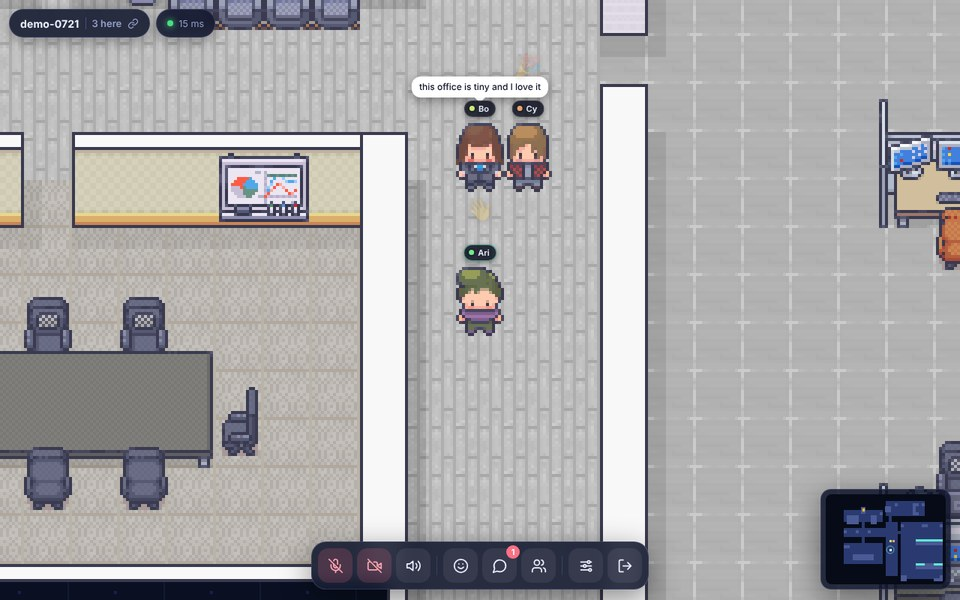

# My Space

A tiny pixel-art office in your browser. Walk around with friends or teammates, step close to someone to talk with voice and video, sit at a computer to share your screen, or just chat. No sign-up.



## Features

- **Nine linked maps**: the Office (hub), Library, Classroom, Lounge, Conference Hall, Game Room, Cafe, Apartment and Auditorium. Walk onto a glowing door to go through; each map has its own seats, computers, voice/video and minimap, and chat follows you everywhere.
- **Phaser 3 office** built from Tiled maps: walls, desks, chairs, vending machines, whiteboards, depth-sorted sprites.
- **Four characters** (Adam, Ash, Lucy, Nancy) with idle, run and sit animations.
- **Controls**: WASD / arrows, click-to-walk (8-way A\* with smoothing), minimap click, touch joystick on phones.
- **Sit** on chairs (`E`) and **use computers** (`R`).
- **Proximity voice and video** (WebRTC mesh). Connects when you get close, fades with distance.
- **Screen share** from a computer, visible only to people at the same computer.
- **Chat, emotes** (`1`–`8`), speech bubbles, name tags, people list.
- **Rooms**: `lobby` is always open; make up any room name, optionally with a password, and share the invite link.
- **Authoritative server**: speed and wall validation, seat/computer ownership, rate limits, per-IP caps, heartbeat, sanitised input.
- **Resilient**: automatic reconnect that rejoins where you were.
- **Tests**: server integration tests (rules, rate limits, doors between maps), plus client tests that check every map's tiles, doors and that every chair, computer and door is reachable on foot.

## Quick start

Requires Node 20+.

```bash
npm run setup   # installs client + server dependencies
npm run dev     # server on :8080, client on :5173
```

Open http://localhost:5173, pick a name, and walk in. Open a second tab (or send the link to a friend on your network) to see each other.

## Controls

| Input | Action |
| --- | --- |
| WASD / arrows | Move |
| Click / tap map or minimap | Walk there |
| `E` | Sit / stand |
| `R` | Use / leave a computer |
| `Enter` | Chat |
| `1`–`8` | Emotes |
| `M` / `V` | Mic / camera |

## Production

```bash
npm run build   # builds client/dist
npm start       # server also serves client/dist on :8080
```

### Docker

```bash
docker build -t myspace .
docker run -p 8080:8080 myspace
```

### Render

`render.yaml` is included: create a Blueprint from the repo.

### Split hosting (e.g. Vercel + a Node host)

1. Deploy `server/` to any Node host (it needs WebSockets).
2. Deploy `client/` as a static site and set `VITE_SERVER_URL=https://your-server` at build time.
3. On the server, set `ALLOWED_ORIGINS=https://your-client`.

`client/vercel.json` and `client/public/_redirects` handle the `/home` route.

## Configuration

Server (`server/.env.example`):

| Variable | Default | Purpose |
| --- | --- | --- |
| `PORT` / `HOST` | `8080` / `0.0.0.0` | Listen address |
| `ALLOWED_ORIGINS` | any | Comma-separated allowed origins for CORS and WebSocket |
| `MAX_ROOM_PLAYERS` | `40` | Players per room |
| `MAX_ROOMS` | `100` | Concurrent rooms |
| `TRUST_PROXY` | off | Use `X-Forwarded-For` for per-IP limits behind a proxy |
| `ICE_SERVERS` | public STUN | JSON array of ICE servers. Add a TURN server for reliable voice/video across strict NATs |
| `CLIENT_DIR` | `../client/dist` | Built client to serve |

Client (`client/.env.example`): `VITE_SERVER_URL` (leave empty to use the same origin).

## Maps and doors

| Map | How to get there |
| --- | --- |
| Office | where you start |
| Library | glowing door at the west end of the corridor, below the pool room |
| Lounge | the stairs at the bottom of the long corridor |
| Classroom | glowing door in the open east office |
| Conference Hall | door at the bottom of the Library, right of the Office door |
| Game Room | left door at the bottom of the Lounge |
| Cafe | right door at the bottom of the Lounge |
| Apartment | door at the bottom right of the Cafe |
| Auditorium | door at the bottom right of the Classroom |

Every map has a door back to the map it hangs off (the Office is the hub). Standing on a door for a moment takes you through; the server checks you are really on it.

**Adding a map**

1. Make a Tiled map (32 px tiles) with the same layers as the existing ones (`Ground`, object layers for furniture, `Chair`, `Computer`, ...) and save it as `client/public/assets/map/<id>.json`.
2. Add a `Portal` object layer. Each door is a rectangle named e.g. `to-office` with properties `to` (map id), `toPortal` (the door on the other map that leads back here), `label`, and `landx` / `landy` (where people appear when they arrive *through this door*, in pixels, on open floor and not on a door).
3. Add the map to `client/src/game/maps.json` and give the other map a door that leads to it.
4. Run `npm run build:world` (rebuilds the server's collision data and checks that every door links back) and `npm test`.

## Project layout

```
client/   Vite + Phaser front end (index.html landing, home.html app)
  src/game     scenes, avatars, pathfinding, map loading
  src/media    WebRTC voice, video, screen share
  src/net      WebSocket client
  src/ui       HUD, labels, minimap, joystick
server/   Node ws server
  src/Room.js        game rules and validation
  src/GameServer.js  rooms, joins, limits
  scripts/build-world.mjs  regenerates data/worlds/*.json (collision, chairs, doors) from the maps
```

If you change the map, run `npm run build:world` so the server's collision data matches.

## Protocol

JSON over WebSocket with short keys, for example `{t:"move", x, y, a}` for movement and `{t:"portal", id}` to use a door. See `server/src/Room.js` and `client/src/net/protocol.js`. WebRTC signalling travels over the same socket. `GET /health` and `GET /stats` are available over HTTP.

## Tests

```bash
npm test   # server + client
```

## Credits

The office map, all tilesets (including the library/classroom set used by the extra maps) and the character sprites come from [rshdhere/metaverse](https://github.com/rshdhere/metaverse). Their licences and the original artists' terms apply, so check them before using this commercially. Pixelify Sans is licensed under the SIL OFL.
