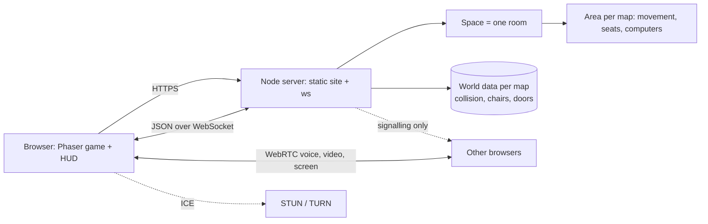

<p align="center">
  <a>
       
  </a>
</p>
<p align="center">
 a tiny multiplayer pixel art office in your browser: walk, talk, share a screen, no sign up
</p>


<p align="center">
  <a href="#run-it"></a>
  <a href="#architecture"></a>
  <a href="#architecture"></a>
  <a href="#architecture"></a>
  <a href="#architecture"></a>
  <a href="#hardware-notes"></a>
</p>


> **Honest framing.** My Space is a small, single-server hobby project, not a managed platform. There is no database, no accounts and no autoscaling: rooms live in memory and disappear when the server restarts. Voice and video are a peer-to-peer mesh, so they are meant for small groups standing close together, not for hundreds of people. Several things have only been tested in a headless browser and against the test suite (see [Known limitations](#known-limitations)).


## Table of contents

1. [Capabilities](#capabilities)
2. [Run it](#run-it)
3. [Using My Space](#using-my-space)
4. [Configuration](#configuration)
5. [Services](#services)
6. [Hardware notes](#hardware-notes)
7. [Architecture](#architecture)
8. [Design decisions](#design-decisions)
9. [Project layout](#project-layout)
10. [Testing](#testing)
11. [Local development](#local-development)
12. [Extending](#extending)
13. [Troubleshooting](#troubleshooting)
14. [Known limitations](#known-limitations)


## Capabilities

**World**

| Capability | Detail |
| --- | --- |
| Sixteen linked maps | Office (hub), Library, Classroom, Lounge, Conference Hall, Game Room, Cafe, Apartment, Auditorium, Cinema, Bedroom, Study, Dining Hall, Coworking, Archive and Computer Lab |
| Tunnel doors | Walk into a tunnel entrance to change map; the server checks you are really standing at it, with a cooldown |
| Tiled maps | 32 px tiles, depth-sorted sprites, walls, desks, chairs, vending machines, whiteboards, rugs |
| Characters | Adam, Ash, Lucy and Nancy, each with idle, run and sit animations |
| Per-map state | Seats, computers, voice and the minimap are per map; chat and history follow you everywhere |

**Moving around**

| Capability | Detail |
| --- | --- |
| Controls | WASD / arrows, click-to-walk (8-way A\* with line-of-sight smoothing), minimap click, touch joystick on phones |
| Sit | `E` on a chair; the server decides who owns the seat |
| Use a computer | `R` at a computer to share your screen with the people at that same computer |
| Clicking past a door | A click-walk only takes a tunnel if it ends on it, so you can cross a door area without leaving |

**Talking**

| Capability | Detail |
| --- | --- |
| Proximity voice and video | WebRTC mesh; connects when you get close and fades with distance |
| Screen share | Only visible to people at the same computer |
| Chat | Shared across all maps, with history for people who join late |
| Emotes and bubbles | Keys `1`-`8`, speech bubbles and name tags, drawn with Font Awesome icons |
| People list | Who is online and in which map, with mic and camera state |

**Server**

| Capability | Detail |
| --- | --- |
| Authoritative | Speed and slack checks, wall checks against per-map collision data, seat and computer ownership |
| Limits | Token-bucket rate limits per connection, per-IP caps, heartbeat, 16 KB message cap, sanitised input |
| Rooms | `lobby` is always open; any other name is created on demand, optionally with a password |
| Resilient | Automatic reconnect that puts you back where you were, on the map you were on |


## Run it

You need **Node 20+**. Nothing else: there is no database and no build step for the server.

```bash
npm run setup   # installs client + server dependencies
npm run dev     # server on :8080, client on :5173
```

Open http://localhost:5173, pick a name, and walk in. Open a second tab (or send the link to a friend on your network) to see each other.

For production:

```bash
npm run build   # builds client/dist
npm start       # the server also serves client/dist on :8080
```

| Setup | Result |
| --- | --- |
| One Node process | Full system: site, game server, signalling |
| Docker (`Dockerfile`) | Same thing in a container |
| Render free web service (`render.yaml`) | One free instance serves the site and the websocket |
| Client on a static host + server elsewhere | Works; set `VITE_SERVER_URL` and `ALLOWED_ORIGINS` |
| No TURN server | Voice and video work on most networks; add one for strict NATs |
| No microphone or camera | Everything else works; you can still chat, emote and share a screen |


## Using My Space

| Step | Input | What happens |
| --- | --- | --- |
| 1 | Pick a name and a character, press join | You appear in the Office (or on the map you were last on) |
| 2 | WASD / arrows, or click the map or minimap | Walk; the server validates every step |
| 3 | `E` next to a chair | Sit down; press `E` again to stand |
| 4 | `R` next to a computer | Use it; share your screen with others at the same computer |
| 5 | Get close to someone | Voice and video connect and fade with distance |
| 6 | Walk into a tunnel | Change map; the people list shows who is where |
| 7 | `Enter`, `1`-`8` | Chat and emotes |
| 8 | `M` / `V` | Mute the mic / turn the camera on or off |

**Things to try**

- Open two tabs in the same room, sit at the same computer and share a screen: only the two of you see it.
- Walk Office, Library, Archive and back: the count at the top shows how many people are in each map.
- Reload the page in the Library: you come back in the Library, not at the Office.
- Make up a room name, add a password, and send the invite link to a friend.


**Maps and tunnels**

| Map | How to get there |
| --- | --- |
| Office | where you start (the hub) |
| Library | tunnel at the west end of the corridor, below the pool room |
| Classroom | tunnel in the open east office |
| Lounge | the stairs at the bottom of the long corridor |
| Conference Hall | tunnel at the bottom of the Library, right of the Office tunnel |
| Archive | tunnel at the bottom left of the Library |
| Game Room | tunnel at the bottom left of the Lounge |
| Cafe | tunnel at the bottom right of the Lounge |
| Cinema | tunnel at the bottom right of the Game Room |
| Dining Hall | tunnel in the middle of the Cafe's bottom wall |
| Apartment | tunnel at the bottom right of the Cafe |
| Bedroom / Study | the two right-hand tunnels in the Apartment |
| Coworking | tunnel at the bottom right of the Conference Hall |
| Auditorium | tunnel at the bottom right of the Classroom |
| Computer Lab | tunnel at the bottom left of the Classroom |

Every map has a tunnel back to the map it hangs off.


</p>

| Key | Action |
| --- | --- |
| WASD / arrows | Move |
| Click / tap map or minimap | Walk there |
| `E` | Sit / stand |
| `R` | Use / leave a computer |
| `Enter` | Chat |
| `1`-`8` | Emotes |
| `M` / `V` | Mic / camera |


## Configuration

Server environment variables (full list in `server/.env.example`):

| Option | Default | Why |
| --- | --- | --- |
| `PORT` / `HOST` | `8080` / `0.0.0.0` | Listen address |
| `ALLOWED_ORIGINS` | any | Comma-separated websites allowed to connect (CORS and websocket) |
| `MAX_ROOM_PLAYERS` | `40` | Players per room, across all its maps |
| `MAX_ROOMS` | `100` | Concurrent rooms |
| `TRUST_PROXY` | off | Use `X-Forwarded-For` for per-IP limits behind a proxy or PaaS |
| `ICE_SERVERS` | public STUN | JSON array of ICE servers; add a TURN server for strict NATs |
| `CLIENT_DIR` | `../client/dist` | Built client to serve |

Client (`client/.env.example`):

| Option | Default | Why |
| --- | --- | --- |
| `VITE_SERVER_URL` | same origin | Set only when the site and the game server are on different hosts |

Built-in limits (`server/src/protocol.js`): names 20 characters, chat messages 280 characters, 50 messages of history, room names 24 characters, 16 KB per message.


## Services

| Service | Where | Purpose |
| --- | --- | --- |
| Website | `client/dist`, served by the Node server (or any static host) | The landing page and the game |
| Game server | `$PORT` (default 8080) | Websocket for movement, chat, seats, doors and WebRTC signalling |
| `GET /health` | Game server | Liveness for hosts and pingers |
| `GET /stats` | Game server | Rooms and player counts, used by the landing page |
| Vite dev server | `:5173`, development only | Hot reload for the client |
| STUN / TURN | External, optional | Lets voice and video cross NATs |


## Hardware notes

No GPU is involved: the browser draws everything and the server only relays small JSON messages.

- **Server:** anything that runs Node 20. One small instance handles a few rooms of tens of people. Voice and video never touch it (only the short signalling messages do).
- **Voice and video:** a full mesh, so every person near you is one extra connection from your browser. That is fine for a handful of people close together and heavy for big crowds.
- **Render free tier:** one free web service is enough. It sleeps after 15 minutes without traffic and rooms are lost on restart, so treat it as a demo host.
- **Phones:** the layout and a touch joystick are built in, but older phones can be slow with many sprites on screen.
- **Strict networks:** add a TURN server in `ICE_SERVERS` if people behind corporate firewalls cannot hear each other.


## Architecture



```
You press a key or click                (WASD, click-to-walk, E, R, Enter ...)
        ↓
Client moves you at once (200 px/s) and sends short messages: {t:"move", x, y, a}
        ↓
Server checks speed + slack, then walls (per-map collision data), then rate limits
        ↓
Walk into a tunnel -> {t:"portal", id} -> server checks reach (56 px) + cooldown -> moves you to the other map
        ↓
Server tells everyone in that map: moves, joined, left, seats, computers, emotes
        ↓
Chat goes to the whole room; voice, video and screen share go peer to peer, with signalling relayed per map
        ↓
Connection drops? the client reconnects and rejoins on the same map at the same spot
```


## Design decisions

- **The server is authoritative.** The client predicts, the server validates speed, walls, seats and doors, and snaps cheaters back. Rate limits, per-IP caps and a 16 KB message cap protect it.
- **Rooms are in memory.** No database means nothing to set up and nothing to leak, at the cost of losing rooms on restart.
- **One room, many maps.** A room (a `Space`) is made of one area per map. Movement, seats, computers and voice are per map; chat and history are shared, so the whole room still feels like one place.
- **Maps are data.** Each map is a Tiled JSON file; a script turns them into the server's collision data, and a manifest (`maps.json`) lists them. Adding a map is a file and a door, not code.
- **Doors are validated twice.** The client only counts you as on a tunnel after a short dwell and only when a click-walk ends there; the server re-checks distance and applies a cooldown.
- **Voice is proximity-based.** Streams connect when you are close and disconnect when you leave, so a big office does not mean a huge mesh.
- **Screen share is scoped.** Only people at the same computer can see it, which keeps casual walking-by from leaking a screen.
- **No emoji, no external icon CDN.** Icons are Font Awesome Free, bundled with the site, so it works offline and looks the same everywhere.


## Project layout

| Path | Role |
| --- | --- |
| `client/` | Vite + Phaser front end (`index.html` landing, `home.html` the app) |
| `client/src/game/` | Scenes, avatars, animations, pathfinding (`nav.js`), map loading (`office.js`, `maps.js`, `maps.json`) |
| `client/src/media/` | WebRTC voice, video and screen share |
| `client/src/net/` | WebSocket client and protocol constants |
| `client/src/app/` | Session state, config, storage, event bus |
| `client/src/ui/` | HUD, name tags and bubbles, minimap, joystick, icons (`fa.js`, `icons.js`) |
| `client/public/assets/` | Maps (`map/`), tilesets, characters, items |
| `server/src/GameServer.js` | Connections, joins, limits, heartbeat, routing |
| `server/src/Space.js` | One room: areas per map, doors, shared chat |
| `server/src/Room.js` | Game rules for one map: movement, seats, computers, signalling |
| `server/src/world.js` | Loads the per-map collision data |
| `server/scripts/build-world.mjs` | Regenerates `server/data/worlds/*.json` (collision, chairs, doors) from the maps |
| `server/test/`, `client/test/` | Server integration tests and map-integrity tests |
| `scripts/dev.mjs` | Starts server and client together |
| `Dockerfile`, `render.yaml` | Deployment |


## Testing

```bash
npm test   # server + client
```

77 tests in total. The 35 server tests start a real server and connect real websocket clients: joining, name and text sanitising, speed and wall checks, rate limits, seats and computers, signalling isolation, emote allowlist, reconnect to a saved position, oversized frames, and the doors between maps (travel, too far, cooldown, map isolation, shared chat, cleanup).

The 42 client tests check every map: tilesets and frames exist, chair directions are valid, every door has a way back with a landing on open floor, and every chair, computer and door can be reached on foot from every arrival point.

There is no CI workflow in this repo yet.


## Local development

```bash
npm run setup
npm run dev                  # server on :8080, client on :5173
npm run build:world          # after changing a map, rebuild the server's collision data
npm test
```

Run just one half:

```bash
npm run dev --prefix server
npm run dev --prefix client
```


## Extending

**Adding a map**

1. Make a Tiled map (32 px tiles) with the same layers as the existing ones (`Ground`, furniture object layers, `Chair`, `Computer`, ...) and save it as `client/public/assets/map/<id>.json`.
2. Add a `Portal` object layer. Each tunnel is a rectangle named like `to-office` with properties `to` (map id), `toPortal` (the tunnel on the other map that leads back here), `label`, and `landx` / `landy` (where people appear when they arrive *through that tunnel*, in pixels, on open floor and not on a tunnel).
3. Add the map to `client/src/game/maps.json` (`id`, `name`, `file`, and a Font Awesome icon name) and give another map a tunnel that leads to it.
4. Run `npm run build:world` (rebuilds the collision data and checks that every door links back) and `npm test`.

**Other changes**

- **New emote:** add its id to `EMOTES` in both `protocol.js` files and an icon in `client/src/ui/fa.js`.
- **New map icon:** add the Font Awesome name to `maps.json` and its glyph to `GLYPH` in `client/src/ui/fa.js`.
- **New message type:** add a handler in `GameServer.js` (with a rate-limit bucket) and document it at the top of `server/src/protocol.js`.
- **New furniture layer:** add it to `DECOR_LAYERS` in `client/src/game/office.js` and to the layer lists in the tests.


## Troubleshooting

| Problem | Fix |
| --- | --- |
| `EADDRINUSE` / port 8080 busy | Another copy is running; stop it or set `PORT` |
| Page loads but you cannot join | Check the server is running; when hosted separately, set `VITE_SERVER_URL` and `ALLOWED_ORIGINS` |
| "Cannot find package 'ws'" | Run `npm run setup` |
| No voice or video | Allow the microphone and camera in the browser; add a TURN server for strict NATs |
| People can see you but not hear you | You are probably too far apart: voice only connects when you are close |
| Walking into a tunnel does nothing | Stand inside the tunnel itself for a moment; there is a short cooldown after each trip |
| Rubber-banding on a slow device | The server snaps you back when your movement looks too fast; close other heavy tabs |
| You are stuck in a wall after editing a map | Run `npm run build:world` so the server's collision data matches |
| Map tests fail after adding a map | The message names the unreachable chair, computer or door; move the furniture or the landing |
| Render service seems down | The free instance was asleep; the first request wakes it |


## Known limitations

- **Mostly tested in a headless browser.** The test suite and a scripted Chromium cover movement, doors, voice setup and the layouts, but real microphones, real networks and many simultaneous users have had little testing.
- **Mesh voice and video** does not scale to big crowds; it is built for small groups standing close together.
- **No TURN server is bundled.** Strict networks may not connect without one.
- **Rooms are not saved.** A restart clears every room and the chat history.
- **No accounts.** Names are not unique and nothing proves who is who; room passwords are the only access control.
- **Single process.** One server holds every room; there is no clustering.
- **Chat is plain text** with no moderation tools beyond rate limits and sanitising.
- **Maps are built from a fixed tileset set**, so new rooms reuse the same furniture.
- **The `/stats` page** shows counts only; there is no admin interface.
